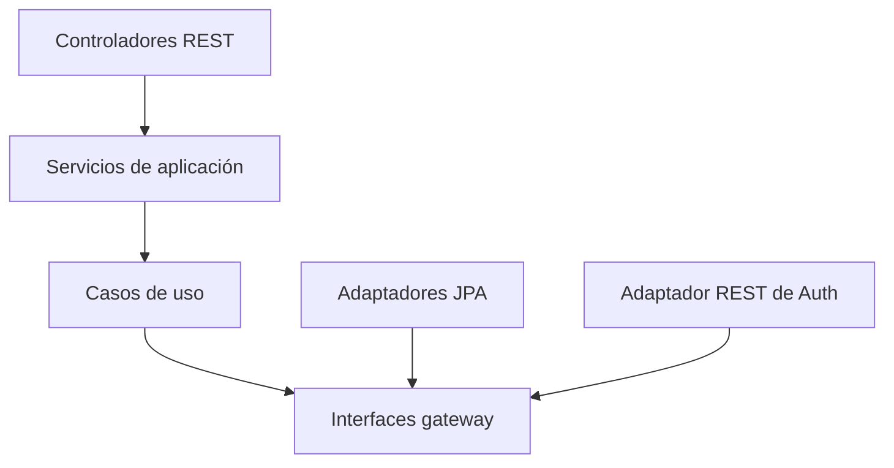

# Arquitectura limpia y principios SOLID

## Flujo de dependencias

El dominio no depende de controladores, JPA, PostgreSQL ni del cliente HTTP.
Infraestructura implementa los puertos definidos por el dominio.

## Aplicación de SOLID

- **Responsabilidad única:** `ProductoUseCase`, `CarritoUseCase` y
  `CompraUseCase` atienden reglas diferentes. Los controladores solo traducen
  HTTP y los adaptadores solo conectan tecnologías externas.
- **Abierto/cerrado:** otro mecanismo de persistencia o comunicación con Auth
  puede agregarse implementando los gateways, sin cambiar los casos de uso.
- **Sustitución de Liskov:** las implementaciones JPA/REST y los dobles usados
  en pruebas respetan los mismos contratos del dominio.
- **Segregación de interfaces:** los puertos `ProductoGateway`,
  `CarritoGateway` y `AuthGateway` son pequeños y específicos.
- **Inversión de dependencias:** los casos de uso dependen de abstracciones;
  Spring conecta las implementaciones desde `CatalogoConfig`.

## Compra distribuida

La compra usa una saga orquestada sencilla:

1. Bloquear carrito y productos y validar carrito activo, cantidades y stock.
2. Recalcular el total dentro del servidor.
3. Solicitar a Auth el débito con `COMPRA-{carritoId}`.
4. Descontar inventario y marcar el carrito como comprado en una transacción
   local.
5. Si el paso local falla después del débito, solicitar el reintegro a Auth.

El débito y el reintegro son idempotentes. Así, reintentar una petición por una
caída de red no genera dos cobros.
