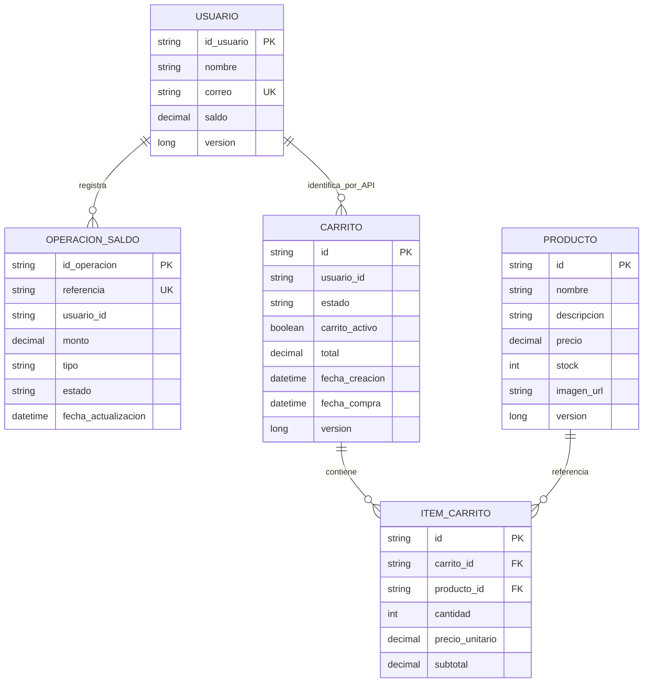

# Modelo Entidad-Relación

## Interpretación

- `Usuario` y `OperacionSaldo` pertenecen exclusivamente a la base de Auth.
- `Producto`, `Carrito` e `ItemCarrito` pertenecen exclusivamente a la base de
  Catálogo.
- La línea `Usuario–Carrito` es una relación lógica mediante `usuario_id` y una
  API REST; **no es una clave foránea física** entre bases de datos.
- Un carrito contiene muchos ítems y cada ítem referencia un producto.
- La combinación `carrito_id + producto_id` es única, por lo que agregar el
  mismo producto incrementa la cantidad en lugar de duplicar filas.
- `precio_unitario` y `subtotal` conservan la fotografía monetaria usada por el
  carrito; al comprar se recalculan con el precio vigente.
- La combinación `usuario_id + carrito_activo` impide más de un carrito activo
  por usuario. Al comprar, `carrito_activo` pasa a `NULL`.
